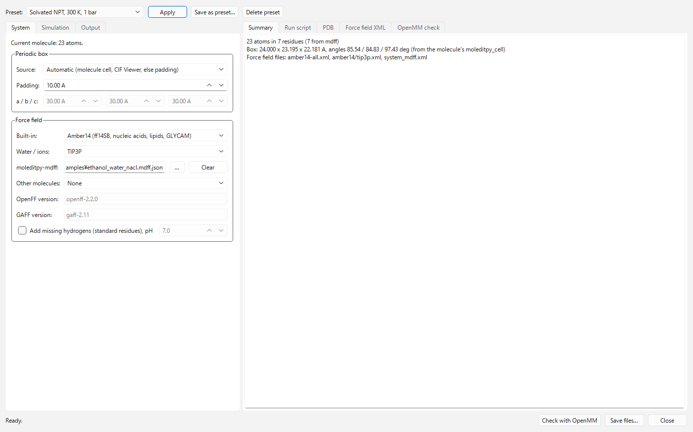
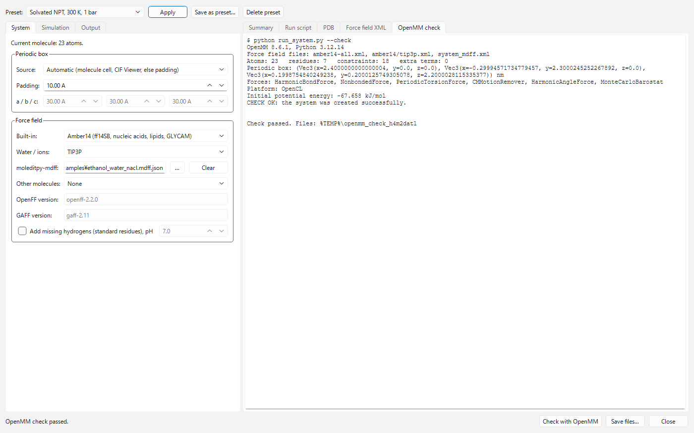
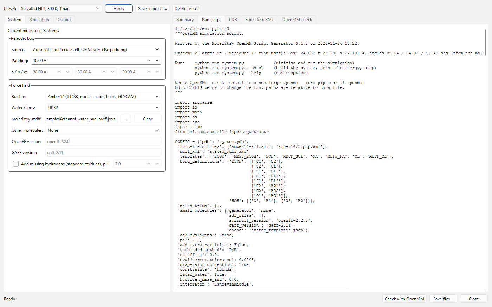
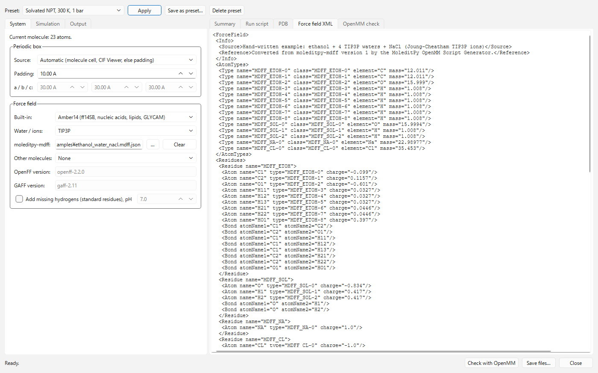

# MoleditPy OpenMM Script Generator

[](https://github.com/HiroYokoyama/moleditpy_openmm_script_generator/actions/workflows/test.yml)
[](https://github.com/HiroYokoyama/moleditpy_openmm_script_generator/tags)
[](https://github.com/HiroYokoyama/moleditpy_openmm_script_generator/releases)

A [MoleditPy](https://github.com/HiroYokoyama/python_molecular_editor) plugin that
writes a self-contained **OpenMM** run script, a PDB with the periodic box, and an
OpenMM force field XML for your own small molecules, with a live preview of every
file before you save.



## What it does

- **Files written**
  - `run_<name>.py`: one Python script with every setting in a `CONFIG` block at
    the top. It needs only OpenMM (plus openmmforcefields when you ask for it).
  - `<name>.pdb`: the system with residue and atom names, a `CRYST1` record for
    periodic boxes, `TER` records and `CONECT` for non-standard residues
  - `<name>_mdff.xml`: an OpenMM ForceField XML converted from a moleditpy-mdff
    JSON file, when one is given
  - `<name>_<RES>.sdf`: one SDF per small-molecule residue when openmmforcefields
    parameterises them
- **Force fields**
  - built-in Amber14 (ff14SB, nucleic acids, lipids, GLYCAM) or CHARMM36 for
    proteins, with the matching water and ion files (TIP3P, TIP3P-FB, SPC/E,
    TIP4P-Ew, TIP4P-FB, OPC, OPC3, TIP4P/2005, TIP5P)
  - small molecules from a **moleditpy-mdff** JSON (nm, kJ/mol, degrees, e, amu),
    converted to OpenMM ForceField XML
  - or from **openmmforcefields** (OpenFF/SMIRNOFF or GAFF)
- **Periodic box**
  - the cell of the current molecule (`moleditpy_cell`) or of the CIF Viewer
    panel, rotated into OpenMM's reduced orientation (triclinic cells included)
  - a box with padding around the molecule, explicit box lengths, or no box
- **Simulation settings**: PME, LJ-PME, Ewald or cutoff electrostatics,
  dispersion correction, constraints, rigid water, hydrogen mass repartitioning,
  Langevin middle or Verlet integrator, temperature, friction, time step, Monte
  Carlo barostat, energy minimisation and number of steps
- **Output**: DCD, extended XYZ (with `Lattice=`), PDB trajectory, state data CSV,
  checkpoints, and platform (CUDA, OpenCL, CPU, Reference) with precision
- **Presets**: vacuum quick test, solvated NVT, solvated NPT, and NPT with HMR at
  4 fs. You can also save your own.
- **Checks** before saving: cutoff against the box size, missing water models,
  a force field that disagrees with the mdff 1-4 scaling, an mdff file that does
  not match the molecule, and residues with no parameters
- **Check with OpenMM**: if an interpreter with OpenMM is available, the dialog
  runs `run_<name>.py --check` in a separate process. The check builds the
  system and prints its forces and initial energy. OpenMM is never a dependency
  of the plugin.



## The run script

```bash
python run_system.py                  # minimise and run
python run_system.py --check          # only build the system and report
python run_system.py --platform CPU --steps 1000 --no-minimize
```

Before it creates the system, the script checks which residues no force field
covers. It names them and says what to add: a moleditpy-mdff file, an
openmmforcefields generator, or a water model. If OpenMM itself is missing, it
says how to install it.



## moleditpy-mdff conversion

Every molecule type in the mdff file becomes one residue template. Its residues are
pinned by name in `createSystem(residueTemplates=...)`. Each atom gets its own atom
type, so charges and Lennard-Jones parameters are exactly the mdff values.

OpenMM matches templates on the bond graph alone. That means symmetry-equivalent
atoms, such as the three methyl hydrogens, can be matched in any order. The
converter enumerates the graph's symmetries to handle this:

- Terms that are identical under every symmetry go into the XML.
- Terms that are not are added by the script after `createSystem`, by atom name.
  These include asymmetric charges, angles, torsions, several impropers on one
  centre, duplicate bonds and constraints.

The resulting energies match a system built term by term from the mdff file.

**Proteins from Force Field Builder** are not converted. Their molecule type is marked
`Amber ff14SB (proteins)`, and OpenMM's `amber14-all.xml` is the same force field, so the
protein atoms are written as ordinary PDB residues and OpenMM assigns them from its own
residue templates. The other molecule types of the file are converted as above. With a
CHARMM protein force field selected, such a file is an error.

Impropers are written with the atom ordering OpenMM expects. The 1-4 scaling of
the mdff file must agree with the built-in force field: Amber uses 0.8333/0.5,
CHARMM uses 1.0/1.0. The dialog refuses combinations OpenMM would reject.



## Install

Plugin Manager: install from the MoleditPy plugin registry, or drop the
`openmm_script_generator` folder into your MoleditPy plugins directory.

The plugin needs nothing beyond MoleditPy itself. Running the scripts needs
[OpenMM](https://openmm.org) (`conda install -c conda-forge openmm` or
`pip install openmm`). openmmforcefields is optional and only needed for
OpenFF/GAFF small molecules.

## Use

**File → Export → OpenMM Script...**

1. Choose a preset, or set up the *System*, *Simulation* and *Output* tabs.
2. Check the previews.
3. Optionally press **Check with OpenMM**.
4. Press **Save files...**.

The settings are stored with the project file. The molecule's `moleditpy_cell` is
also stored there, because MoleditPy does not keep molecule properties across
undo or project save.

## Shared modules

`cell_model.py`, `elements.py`, `cell_preview.py` and `structure_panel.py` are
owned by
[`moleditpy-periodic-shared`](https://github.com/HiroYokoyama/moleditpy-periodic-shared)
and vendored through the `_periodic_shared` git submodule. They are not committed
directly. `scripts/materialize_shared.py` copies them into the package at
test and build time:

```bash
git submodule update --init
python scripts/materialize_shared.py
```

## Tests

```bash
python -m pytest tests/ -v
```

The OpenMM tests run when OpenMM is importable, or when `OPENMM_PYTHON` points to
an interpreter that has it.

## Licence

GNU Lesser General Public License v3.0 or later. See [LICENSE](LICENSE).

## Licensing scope

First-party code is LGPL-3.0-or-later. See [LICENSE](LICENSE), [COPYING](COPYING)
and [dependency/provenance terms](LICENSING.md). Third-party components retain
their own terms.
